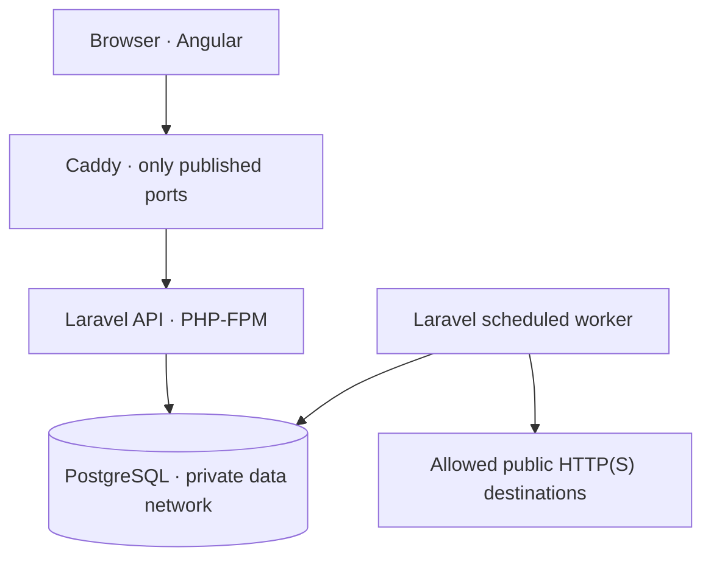

# InfraWatch

A small infrastructure availability and incident-management portfolio project. Angular frontend, Laravel REST API and scheduler, PostgreSQL, Docker Compose, and Caddy.

**Implementation status:** the application and deployment files are implemented. The Angular production build, frontend status tests, and backend SQLite tests have run locally. The Docker/PostgreSQL stack, live socket tests, image/dependency scans, and PostgreSQL restore verification have **not** run in this environment. See [verification evidence](docs/VERIFICATION.md). Do not describe this as a verified production deployment.

## Start locally

Run from this project directory using Bash on Linux, macOS, or WSL2 with Docker Engine/Desktop and Docker Compose v2. Docker must be installed and running. No paid resources or external deployment are required.

```bash
docker version
docker compose version
bash scripts/init.sh
docker compose config --quiet
docker compose build
docker compose up -d --wait --wait-timeout 240
docker compose exec -T api php artisan db:seed --force
docker compose exec -T worker php artisan monitor:check
curl --fail http://localhost:8080/api/health
docker compose ps
```

Open **http://localhost:8080**. The demo accounts are `admin@infrawatch.test` and `viewer@infrawatch.test`. Read the randomly generated `DEMO_PASSWORD` in your local `.env`; both demo accounts use it. There are no committed account passwords. The seed is idempotent, does not reset existing users, and refuses production. It adds a real `https://example.com/` monitor, with no fabricated check history.

`scripts/init.sh` creates `.env` with random application, database, and demo secrets and restrictive file permissions. It refuses to overwrite an existing file. Keep that file private. Do not paste it into issues or commit it.

The local site uses HTTP. For a public server, follow [Ubuntu deployment](docs/DEPLOYMENT.md), enable HTTPS and secure cookies, and create personal accounts instead of demo users.

```bash
# Stop containers while preserving PostgreSQL and Caddy data.
docker compose down

# Start again; migrations run before API and worker startup.
docker compose up -d --wait --wait-timeout 240
```

Do not add `--volumes` to the stop command unless you intend to destroy this installation's data.

## What it does

| Capability | Behavior |
|---|---|
| Authentication | Same-origin session cookies; login throttled to 5 attempts/minute; no registration endpoint |
| Authorization | Admins create, edit, pause and delete services and read audit logs; both roles read checks and acknowledge/resolve incidents |
| Destinations | Exact deployment-configured hostname allowlist; HTTP:80 or HTTPS:443; no URL credentials, queries, fragments or redirects |
| Monitoring | Up to 50 configured services; sequential checks, scheduled each minute; records HTTP status, total elapsed milliseconds, DNS addresses and TLS expiry when obtainable |
| Availability | Only completed HTTP 2xx responses are up; redirects, transport errors, TLS validation errors and limits are failures |
| Incidents | First failed check opens an incident; acknowledged incidents remain active; PostgreSQL partial unique index prevents a second active incident |
| Recovery | Successful checks do not silently resolve incidents; users resolve them manually; another failure after resolution creates a new incident |
| Dashboard | Real latest check, stale/pending/paused states, and latest 60 checks per service; refreshes every 15 seconds |
| Audit | Actor, action, subject ID and deliberately selected metadata; service URL, password, cookie and raw request bodies are not included in audit entries |

Deleting a service deletes its checks and incidents; its audit events remain. A URL edit keeps older history, but the current status uses only checks for the current URL. Results from an old URL that finish after an edit are discarded. Incident history remains associated with the service, even across URL changes.

## Architecture



Caddy serves the compiled Angular files and forwards `/api/*` to PHP-FPM. API and database have no published host ports. The API connects to the internal edge and data networks. The worker connects to the data network and a separate outbound network for probes. Caddy also has outbound access for certificate issuance.

See [protocol and networking explanations](docs/CONCEPTS.md), [security boundaries](docs/SECURITY.md), and [interview guide](docs/INTERVIEW.md).

## Destination configuration

Edit the comma-separated, lowercase, exact hostname list in `.env`:

```dotenv
MONITOR_ALLOWED_HOSTS=example.com,status.your-domain.example
```

Use only domains you own or have permission to check. Wildcards, IP literals, localhost and private destinations are unsupported. A hostname resolving to any private or special-use address is rejected, including mixed public/private answers. The worker revalidates configuration on every check and pins one validated IP for the request. DNS may change between passes; it cannot redirect the current HTTP request to an unvalidated address through a second lookup.

After changing environment configuration:

```bash
docker compose up -d --force-recreate --wait --wait-timeout 240
```

Removing a hostname causes its existing enabled services to fail with `destination_rejected`, producing incidents. Pause or edit those services first if that is not your intention.

## Accounts

For an installation without demo data:

```bash
docker compose exec api php artisan infrawatch:user admin@your-domain.example --role=admin
docker compose exec api php artisan infrawatch:user viewer@your-domain.example --role=viewer
```

Passwords are entered at a hidden prompt and must contain at least 14 characters. This CLI does not change existing accounts. Password reset, MFA and a user-management UI are outside this minimal version.

## Development checks

PHP 8.3 with PDO SQLite/cURL/mbstring/XML, Composer 2, and Node 24 are needed outside Docker. Use PostgreSQL PDO when running tests against PostgreSQL.

```bash
cd backend
composer install
composer validate --strict
composer test
composer lint
# Includes local HTTP socket fixtures; requires permission to open local sockets.
RUN_TRANSPORT_TESTS=1 composer test
cd ../frontend
npm ci --ignore-scripts
npm test
npm run build
cd ..
bash scripts/init.sh # only if .env does not exist
node scripts/smoke.mjs # running Compose stack and seeded demo accounts required
```

The backend test configuration uses in-memory SQLite by default. CI overrides it to a disposable PostgreSQL database and enables transport fixtures. Tests include guests/viewers/admins, CSRF enforcement, login throttling, URL/address rejection, mixed DNS answers, execution-time revalidation, incident deduplication, in-flight edits and disabled services. Transport fixtures check 2xx responses, redirect refusal, body limits and timeouts. They do not establish that every TLS failure mode is covered.

The smoke script creates a temporary real monitor, exercises sessions and roles, runs two monitoring passes, checks the incident invariant, then deletes its temporary service. It uses the configured `example.com` target and can fail when outbound networking or DNS is unavailable.

## CI and operations

GitHub Actions tests against PostgreSQL, builds Angular and Docker images, runs Composer/npm audits, scans the API/proxy/PostgreSQL images using Trivy, then runs HTTP smoke checks and an isolated restore verification. High/critical image findings fail the job, including unfixed findings. Audits and scans require internet access; no passing result is claimed until the workflow actually runs. Dependabot checks Composer, npm, Docker and Actions weekly.

```bash
backup=$(bash scripts/backup.sh)
bash scripts/verify-restore.sh "$backup"
```

Backups contain sensitive application data. See [backup/restore procedure](docs/BACKUPS.md) for verification, recovery, retention and off-host copies. See [deployment](docs/DEPLOYMENT.md) for Ubuntu setup, health checks and rollback, and [demo script](docs/DEMO.md) for a short presentation.

## Deliberate limits

One VM, one worker, no public registration, no notification integrations, no automatic remediation, no performance or SLA claims. At 50 slow destinations, a pass can take several minutes; the scheduler skips overlap instead of guaranteeing a one-minute sampling interval. DNS is limited to 3 seconds and HTTP to 5 seconds; responses are limited to 1 MiB of body and 32 KiB of headers. Only one validated address is tried per pass. Checks and audit records currently have no automatic retention policy; plan database cleanup before long-term use.

Base images and GitHub Actions use maintained version tags rather than immutable digests/SHAs. Lockfiles fix PHP and frontend package versions. Before a production release, review update PRs, pin approved image digests/action SHAs, and retain the exact built images for rollback. This is a portfolio baseline, with the unverified integration paths explicitly listed in the evidence file.
